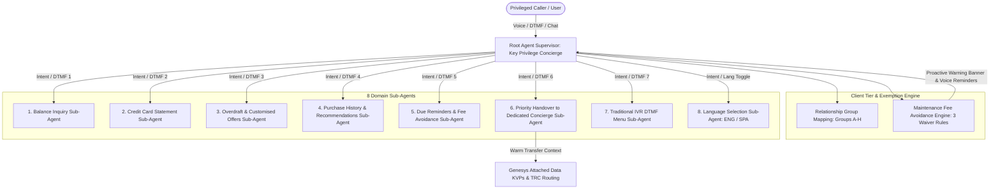

# KeyBank Key Privilege / Private Client Multi-Agent Voice & Chat System
## Technical Architecture & Design Document
**Team Innovators • Hackathon Team 53**

---

## 1. Executive Summary & Problem Statement

High-net-worth and privileged banking customers expect frictionless, proactive, and personalized concierge-level service across both voice and digital channels. In conventional IVR and chat systems:
1. Privileged callers often navigate generic, repetitive menus without immediate recognition of their household relationship tier.
2. Maintenance service charges ($25.00/month on Key Privilege Checking) generate high call volume and friction when customers unintentionally fail to meet monthly exemption criteria.
3. Escalations to human representatives frequently lack context, forcing high-value clients to repeat their account numbers, inquiry history, and financial goals.

**Hackathon Team 53 (Team Innovators)** has engineered an **Agentic Multi-Agent Conversational System** specifically tailored for KeyBank Key Privilege and Key Private Client customers. The solution features:
* **Root Agent Supervisor** coordinating **8 specialized Domain Sub-Agents**.
* **Household Relationship Group Mapping Engine (`A` through `H`)** identifying privileged clients upon ANI/IPI lookup.
* **Proactive Maintenance Service Charge Exemption Engine** tracking the 3 waiver rules in real time and warning customers with actionable recommendations during menu interactions.
* **Priority Contact Center Telephony Routing** generating dynamic Transfer Route Codes (`TRC = KEY_PRIVATE_CLIENT_TRC`, `KEYPRIVCCA`, `MMCCA_SPANISH`) and Genesys Attached Data KVPs.
* **Full Voice & Chat Simulator** with Web Speech API and authentic Web Audio DTMF touch-tone frequencies.

---

## 2. Multi-Agent System Architecture



---

## 3. Privileged Customer Identification Engine

### 3.1 Relationship Group Mapping (`A` - `H`)
In alignment with KeyBank's Core Enterprise Data Warehouse (EDW) and VRU relationship schema (`VRU_APP_SCHEMA.RELATIONSHIP_GROUPS`), clients are mapped based on total household value and primacy:
* **Groups `A` & `B`:** Tier-1 Ultra High Net Worth / Key Private Client (`CustomerTier.PRIVATE_CLIENT`).
* **Groups `C` through `H`:** Key Privilege Banking Clients (`CustomerTier.PRIVILEGED`).
* **Application Types:** `KEYPRIV` (Key Privilege), `PRIVBANK` (Private Bank), sub-product code `PQ` (Privilege Checking).
* **Bank Exclusions & Laurel Road Brand Architecture:** Pure Laurel Road accounts (`bankNumber = 2912` or `3211`) route to `LR_DEFAULT`. KeyBank Retail (`0101`) accounts participate in Key Privilege Primacy.

---

## 4. Maintenance Service Charge Avoidance & Proactive Reminders

### 4.1 The 3 Exemption Criteria
To avoid the **$25.00 monthly maintenance fee** on Key Privilege Checking, the customer must meet **at least one** of the following criteria during each statement cycle:
1. **Rule 1 (Combined Balance):** Maintain a total combined balance of **$25,000.00 or more** across any combination of eligible deposit and asset accounts (Checking, Savings, MMA, CDs, Investments).
2. **Rule 2 (Mortgage Auto-Payment):** Have a KeyBank residential mortgage with automatic payment deductions of **$500.00 or more** from the Key Privilege Checking Account each cycle.
3. **Rule 3 (Key@Work Direct Deposits):** Be a Key@Work program member with recurring direct deposits totaling at least **$2,500.00 or more** during each cycle.

### 4.2 Proactive In-Menu Reminders
When a privileged customer enters the IVR or chat bot, the **Fee Avoidance Engine** computes cycle cutoff dates and remaining days. If none of the 3 rules are currently met:
* The Root Agent immediately presents a prominent **Fee Advisory Banner**.
* The Traditional Menu audio announcement injects a concise warning:
  > *"Important Privilege Reminder: 5 days remaining in your statement cycle! Add $3,550 in combined balance or verify your Key@Work direct deposits to avoid the $25.00 service charge."*
* Actionable remedies are generated automatically (e.g., *"Transfer $3,550 from external account or ensure your remaining $1,300 direct deposit posts before Nov 20"*).

---

## 5. Domain Sub-Agents Specification

| Sub-Agent | Domain Scope | Audio Prompt ID | Primary Output / Telephony Action |
|:---|:---|:---|:---|
| **1. Balance Inquiry** | Checking, Savings, MMA, and combined relationship balance holdings. | `[K2U_ENG.701.au]` | Displays account breakdown & checks progress against $25k waiver rule. |
| **2. Credit Card Statement** | Card balances, min payment due, cycle end, and PDF e-statement links. | `[K2U_ENG.712.au]` | Statement balance, reward points, and available credit limit. |
| **3. Overdraft & Offers** | Overdraft protection (Key Coverage) & customized lending/CD offers. | `[K2U_ENG.720.au]` | 4.85% APY 14-Mo CD, $35k Line of Credit, -0.25% mortgage discount. |
| **4. Purchase History & AI Insights** | Categorized transaction trends & AI reward points optimizer. | `[K2U_ENG.725.au]` | Category spend breakdown (Dining/Travel) & 3x points cash-back advice. |
| **5. Due Reminders & Fee Avoidance** | Upcoming bills, CC due date, mortgage auto-pay, and fee deadline countdown. | `[K2U_ENG.730.au]` | Statement cycle cutoff tracker & gap remedy recommendations. |
| **6. Priority Handover** | Dedicated VIP Concierge & Private Client warm transfer. | `[K2U_ENG.750.au]` | Emits `KEY_PRIVATE_CLIENT_TRC` or `KEYPRIVCCA` + Genesys Attached Data KVPs. |
| **7. Traditional Menu** | IVR touch-tone numbered fallback with embedded fee warning. | `[K2U_ENG.700.au]` | Options 1-7 mapped to touch tones with dual-frequency DTMF audio. |
| **8. Language Selection** | English / Spanish bilingual toggling. | `[K2U_ENG.708.au]` | Updates `sessionKey.languageCode` and redirects to `MMCCA_SPANISH`. |

---

## 6. Priority Telephony Routing & Genesys Attached Data Payload

When the caller requests escalation or selects Option 6, the **Priority Handover Sub-Agent** attaches rich context to the SIP / GVP transfer:
```json
{
  "CustomerIPI": "031379551",
  "CustomerTier": "KEY_PRIVILEGE",
  "RelationshipGroup": "D",
  "PriorityQueue": "TRUE",
  "StopPayment": "false",
  "MaintenanceFeeAtRisk": "YES",
  "TotalCombinedBalance": "21450.00",
  "LanguageCode": "ENG",
  "TRC": "KEYPRIVCCA",
  "masterBotId": "privilegeConcierge"
}
```
* **Private Client TRC:** `KEY_PRIVATE_CLIENT_TRC` (Queue: Key Private Client Wealth Concierge).
* **Key Privilege TRC:** `KEYPRIVCCA` (Queue: Key Privilege Priority Relationship Queue).
* **Spanish Language TRC:** `MMCCA_SPANISH` (Safeguards EDW 20-character telephony column limit).
